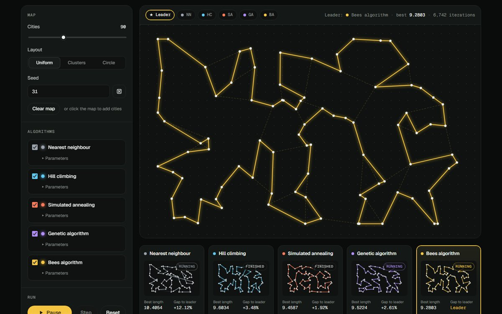

# Metaheuristics Lab



An interactive playground for the **travelling salesman problem (TSP)**. Place cities on a map and watch five strategies race to find the shortest tour, live in the browser:

| Algorithm | Family | Idea in one line |
|---|---|---|
| Nearest neighbour | Constructive heuristic (baseline) | Always go to the closest unvisited city. |
| Hill climbing | Local search | Apply the best 2-opt move until none improves; restart. |
| Simulated annealing | Trajectory metaheuristic | Accept worse moves with probability e^(−Δ/T), cooling T over time. |
| Genetic algorithm | Evolutionary (population) | Tournament selection, order crossover, inversion mutation, elitism. |
| Bees algorithm | Swarm intelligence (population) | Scouts find sites; recruited bees search patches around the best ones. |

Every algorithm gets the **same compute-time budget** on the **same map**, so the results show how each one trades speed for quality.

## Features

- Uniform, clustered or circular maps with any seed, or click the map to add your own cities.
- Run, pause, step one iteration at a time, and pick the animation speed (press <kbd>Space</kbd> to run or pause).
- Tune every parameter, such as the cooling rate, population size and number of bees.
- A **Leader** view that always shows the current best tour, plus a mini-map and live statistics per algorithm.
- A convergence chart of best tour length against compute time.
- Shareable links: the map is encoded in the URL (`#n=80&layout=clusters&seed=7`); add `&run=1` to start the race on load.
- A "How it works" section explaining each algorithm with pseudo-code.

## How it is built

Plain JavaScript ES modules, with **no framework, no dependencies and no build step**.

```
index.html, styles.css
src/
  core/
    rng.js          seeded PRNG (mulberry32), shuffle, gaussian
    tsp.js          instances, distance matrix, tour length, 2-opt move + O(1) delta
    runner.js       Race: time-sliced runner with per-algorithm compute budgets
  algorithms/
    nearestNeighbor.js  hillClimbing.js  simulatedAnnealing.js  genetic.js  bees.js
    index.js        registry: names, colours, parameter definitions
  ui/
    map.js          canvas rendering of cities and tours
    chart.js        convergence chart
    canvas.js       high-DPI canvas helper
  main.js           UI controller and state
tests/              node:test unit tests
```

### Key design decisions

- **Every algorithm has the same interface.** It's a class with `step()`, `best`, `bestLength`, `iteration` and `done`, so the runner and UI treat all of them the same way, and adding a sixth algorithm is one file plus a registry entry.
- **2-opt moves are evaluated in O(1).** Reversing the segment `tour[i..j]` only replaces two edges, so the gain is `d(a,c) + d(b,d) − d(a,b) − d(c,d)`. No tour has to be rebuilt to score a move. Hill climbing, simulated annealing and the bees algorithm all rely on it.
- **Fair comparison by compute time.** The runner gives each active algorithm an equal slice of every animation frame and stops it once it has used its budget. Comparing by iterations would be meaningless, because one GA generation and one SA move cost very different amounts.
- **Reproducibility.** A seeded PRNG drives both map generation and each algorithm, with a different stream per algorithm.
- **The main thread stays responsive.** Work is time-sliced across `requestAnimationFrame` instead of blocking the page, so a Web Worker isn't needed at this scale.

### Algorithm notes

- **Simulated annealing.** The initial temperature T₀ is calibrated automatically: the algorithm samples random moves and sets T₀ so that an average uphill move is accepted with the chosen probability (50% by default). Cooling is geometric (`T ← αT`), with `k × n` moves per temperature level.
- **Genetic algorithm.** Order crossover (OX1) always produces a valid permutation. A pure GA with no local search converges slowly on the TSP; that's a real, well-known result, and it shows up clearly in the race.
- **Bees algorithm.** Pham et al. (2005), adapted to permutations. Each recruited bee lands on a random city of a site's tour and examines every 2-opt move within its "flower patch" (segment length ≤ patch). Patches shrink when a site stagnates, and sites stuck past the stagnation limit are abandoned. The best tour is always remembered.

## Run locally

Any static file server works, because ES modules need to be served over HTTP:

```bash
python -m http.server 8000
# or
npx serve .
```

Then open http://localhost:8000.

## Tests

The tests use Node's built-in test runner, so there's nothing to install (Node 18 or newer):

```bash
npm test
```

They check:
- that the O(1) 2-opt delta always matches the real change in tour length;
- that every algorithm returns a valid permutation with a correctly reported length;
- that 2-opt local search reaches the **known optimum** on convex (circle) instances;
- that compute budgets are enforced and runs are reproducible from the seed.

## Deploy

It's a static site. On Vercel, import the folder (framework preset: **Other**, no build command, output directory: root). On Netlify or GitHub Pages, publish the folder as-is.

---

Built by [Khelfat Badereddine](https://github.com/khbadri16).
